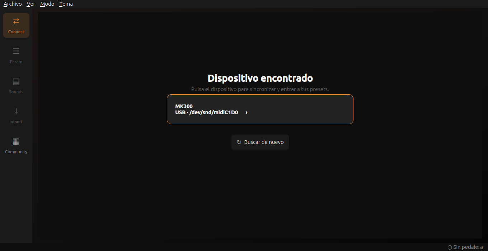
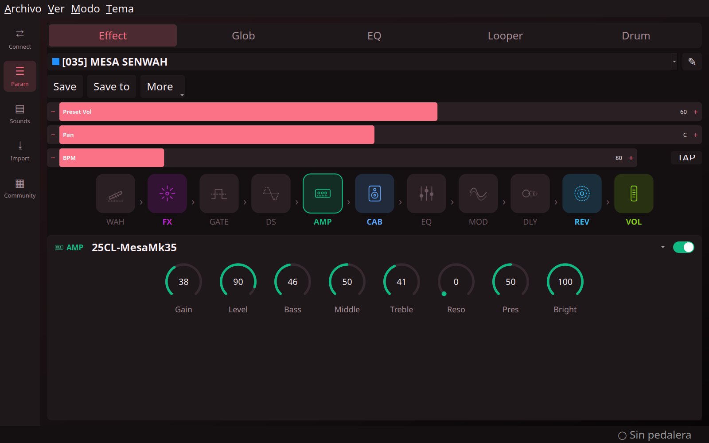
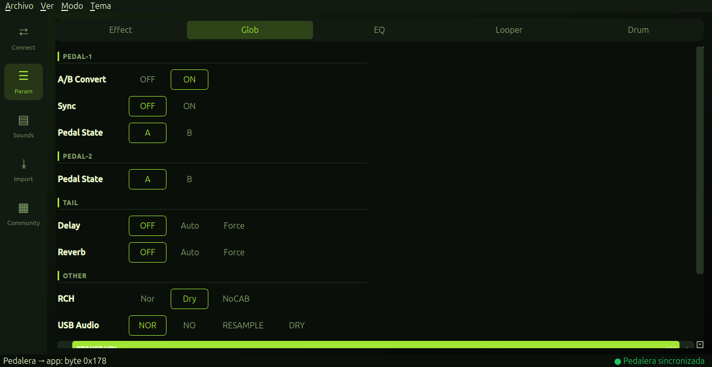
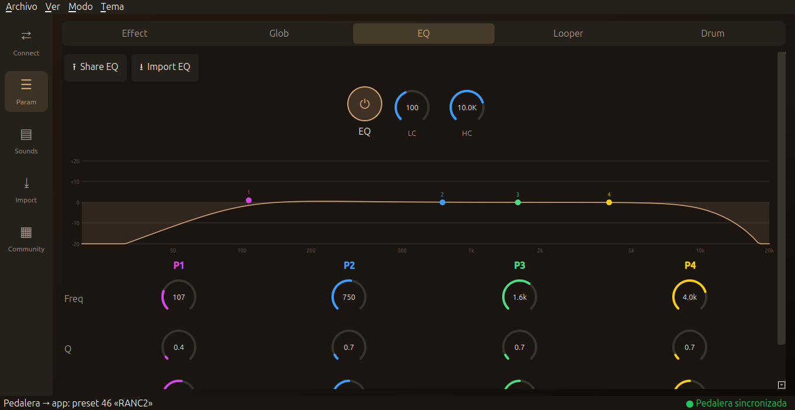
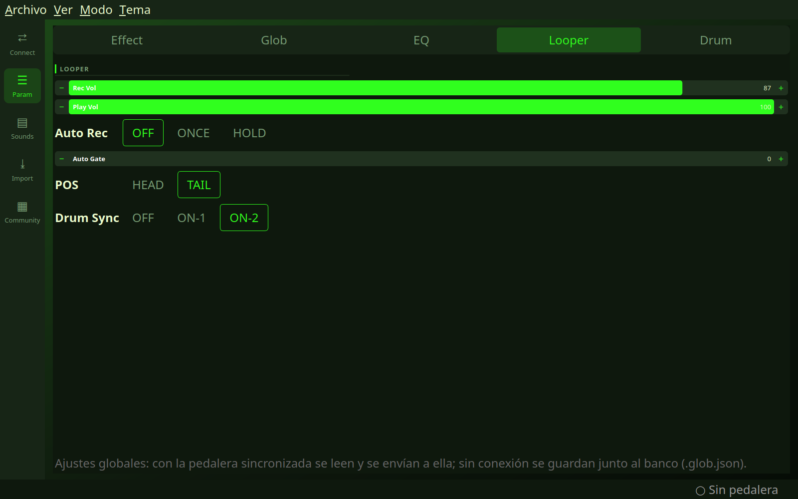
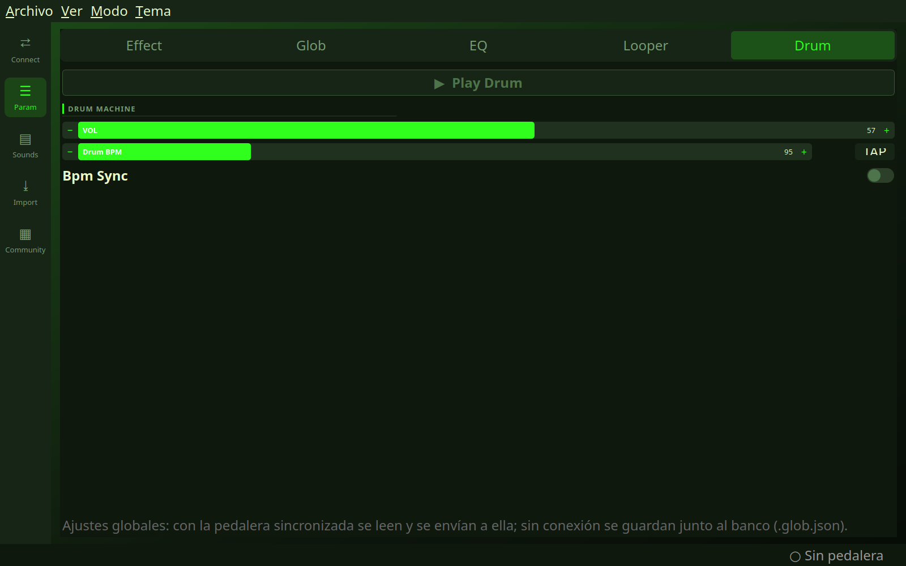

# MK300 Studio

**MK300 Studio** is a desktop editor for the **MK300** pedalboard (USB 3654:7756) on Linux. It does what the
manufacturer's official Windows app does: edit presets, global settings, EQ, Looper and Drum, with the pedalboard
connected over USB and synchronized in both directions.

> Unofficial project, not affiliated with the manufacturer. It was built by reverse engineering the USB-MIDI traffic
> and the original app. **Use it at your own risk**: it writes to the pedalboard's memory.

## Screenshots

| Connection screen | Effect |
|---|---|
|  |  |

| Glob | EQ |
|---|---|
|  |  |

| Looper | Drum |
|---|---|
|  |  |

## What it does

- **Connection screen**: on launch it looks for the pedalboard over USB, and you click the device to enter the presets.
  Without a pedalboard no presets are shown; if it is unplugged, the app returns to that screen on its own.
- On connect it reads the whole bank (160 presets) and opens on the preset that is active on the pedalboard.
- **Live sync**: the active preset and the settings are mirrored in both directions; the status bar shows what changed
  and where it came from. Presets saved or renamed on the pedalboard itself are picked up too, and if the cable is
  unplugged the app reconnects on its own when the pedalboard comes back.
- **Save / Save to** write the preset to the pedalboard's flash, with confirmation and read-back verification.
- Effect, Glob, EQ, Looper and Drum tabs laid out like the official app, a reorderable 11-effect chain, knobs, 8 themes,
  and an interface color that follows the preset's color.
- The names of the amp, cab and distortion models are read from the pedalboard itself on connect, so they always match
  what it displays (a fallback list is used when there is no pedalboard).
- Without a pedalboard, presets are only shown if you deliberately open a `.bin` bank (File → Open): it is edited as a file.

## Status

| Feature | Status |
|---|---|
| Reading the bank, active preset and globals | Tested with the pedalboard |
| Connection screen and return to it on disconnect | Tested with the simulated device; a real cable unplug is untested |
| Live editing and saving presets | Tested (firmware v75, empty presets only) |
| Global settings (Glob, EQ, Looper, Drum) | Map verified against captures of the official app; live sync tested both ways, changes persist on the pedalboard |
| Tail Delay/Reverb | Verified on the pedalboard (read-only, changes made from the pedalboard) |
| Full bank Import/Swap, Factory Restore, Snapshots, IR/Sounds | Not implemented (none of this is written) |

Only firmware **v75** has been tested.

## Requirements

- Linux with ALSA (`amidi`) and Python 3.10+
- `PyQt5` (`pip install PyQt5` or your distribution's `python3-pyqt5` package)
- The MK300 connected over USB. Your user must be able to open `/dev/snd/midiC*D*` (`audio` group); on Ubuntu being
  logged in is usually enough. An optional udev rule is provided in `tools/99-mk300.rules`.

## Installation (.deb package)

```
sh packaging/build_deb.sh            # builds dist/mk300-studio_0.1.0_all.deb
sudo apt install ./dist/mk300-studio_0.1.0_all.deb
mk300-studio                         # or from the applications menu
```

It installs the app in `/usr/lib/mk300-studio` and depends on `python3-pyqt5` and `alsa-utils`. Backups are stored in
`~/.local/share/mk300-studio/backups/`. To remove it: `sudo apt remove mk300-studio`.

## Usage

```
cd mk300-linux
python3 run.py
```

The connection screen appears on launch; click the MK300 device to sync. Its bank is read and a copy is saved to
`~/.local/share/mk300-studio/backups/`.
Close any other application that uses the pedalboard (such as a MIDI editor): the port is exclusive.

## Protocol (summary)

USB-MIDI SysEx. Packet `00 59 <cmd> <len16> 00 <payload> <chk>`, packed to 7 bits inside `F0 … F7`,
with `chk = ~sum(payload)`. Commands: `0x11` identity, `0x23` read, `0x22` write (RAM).

| Address | Contents |
|---|---|
| `0x00000000` | Bank: 160 presets × 448 bytes + `PATCHEND` (flash) |
| `0x10000000` | Active preset (RAM, 448 bytes) |
| `0x20000000` | Global settings (86 bytes); bytes 0–1 = active preset index |
| `0xE0000000 + n` | Writing 1 byte (0) selects preset n |
| `0xF0000000` | Empty write after writing a preset: commits it to flash |
| `0x70200000` | Preset names |
| `0x80000000` / `0x90000000` / `0xA0000000` | CAB / AMP / DS model names (14-byte records `<id><name>`) |

Details and the full map: `analysis/log_windows.md`, `windows/README.md` and `mk300-linux/mk300cfg/`
(`protocol.py`, `device.py`, `bank.py`, `settings.py`).

## Layout

```
mk300-linux/   the app (PyQt5)
packaging/     script that builds the .deb package
tools/         utilities: SysEx capture decoder, command-line reader, catalog extractors
windows/       MIDI captures and notes taken with the official app on Windows
analysis/      reverse-engineering notes
HANDOFF.md     project status and pending work
```

## Safety

- The app writes only to the active preset (RAM), to preset slots you confirm, and to the global settings. It does not
  erase sectors or touch the firmware.
- Before saving important presets, keep a backup (`~/.local/share/mk300-studio/backups/` is created automatically on connect).
- Use only software you have obtained legitimately.

## License

[GPL-3.0 or later](LICENSE). The icons in `mk300-linux/assets/` are original to this project.
"MK300" is the name of its owner's product and is cited only to indicate which hardware this is compatible with.
